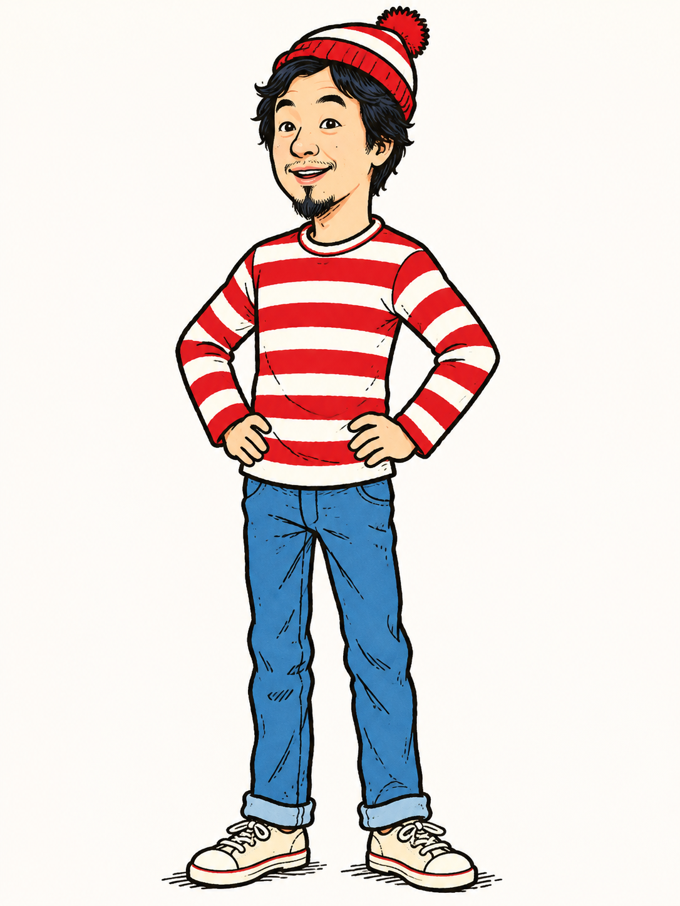
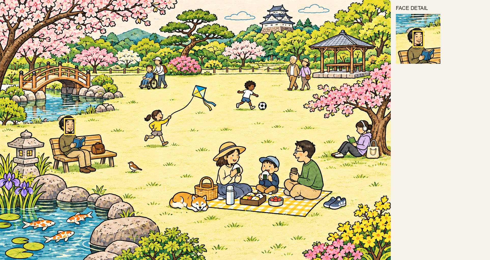
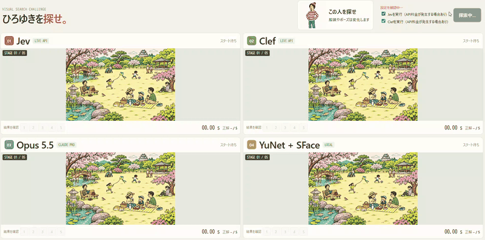

# ひろゆきを探せ！ベンチマーク

人がたくさん描かれたイラストの中から、参照画像の「ひろゆき」を見つけられるか？



**探す対象：この人物の顔**

画像の理解を得意とするAIと、顔検出・顔照合を組み合わせたコンピュータビジョンの手法を、5つのステージで比較する実験です。各手法に同じ参照画像とステージ画像を渡し、対象人物の**顔の位置**を予測してもらいます。



*正解の例：黄色い枠が探す顔の位置です。右側に顔の部分を拡大しています。正解枠は目視による概算です。*

> このベンチマークは、5枚のイラストを各手法で1回ずつ評価した小規模な試作です。結果はこのデータにおける暫定値であり、モデルの一般的な性能や実写映像での性能を示すものではありません。

## プレイ動画 / GIF

**ここにレース画面の動画またはGIFを掲載予定。**

<!-- GIFを追加する場合: 公開内容を確認して docs/media/race.gif に置き、次の行を有効にする。

-->

<!-- 動画を追加する場合: 公開内容を確認して docs/media/race.mp4 に置き、ここに動画へのリンクを追加する。 -->

動画やGIFを公開する前に、画像素材や画面に映る情報の公開可否を確認してください。

## 何を比較したか

| 手法 | どんな方法？ | 実行方法 |
|---|---|---|
| **Jev 1.14.0** | TypeSafeのモデル。参照画像とステージ画像を渡し、該当する顔の矩形をBox機能で求める。 | TypeSafe API |
| **Claude Sonnet 5.5** | Anthropicの画像を理解できるモデル。2枚の画像を読み、対象の顔の矩形を座標で返す。 | Claude Code、サブスク認証 |
| **GPT-6.1 Terra** | OpenAIの画像入力に対応するモデル。参照画像とステージ画像を直接添付し、顔の矩形を求める。 | ChatGPT認証のCodex CLI |
| **Claude Opus 5.5** | Anthropicの画像を理解できるモデル。Sonnetと同じ指示で顔の矩形を座標で返す。 | Claude Code、サブスク認証 |
| **YuNet + SFace** | OpenCVの顔検出モデルYuNetで顔候補を見つけ、顔照合モデルSFaceで参照画像との類似度が最も高い候補を選ぶ。 | ローカル実行、追加学習なし |
| **YuNet + Jev** | YuNetが検出した全顔候補を番号付き一覧にし、参照画像に似た候補をJevに選ばせる。 | ローカルのYuNet + TypeSafe API |

JevとSonnetには顔を囲むよう指示し、YuNet + SFaceは検出した顔の枠を返します。JevのBox confidenceとSFaceの顔の類似度は異なる値であり、直接比較できません。

レース画面には追加実験の **YuNet + Jev** もあります。YuNetで検出したすべての顔を番号付き一覧画像にし、Jevに参照画像と照合して候補を選んでもらいます。SFaceによる絞り込みは行いません。下記の3手法とは別の時刻に評価しました。

## ステージと評価方法

- **画像**：人物の服装やポーズを変え、周囲のイラストになじませた5枚（`data/stages_v3/`）。
- **入力**：各手法に同じ参照画像とステージ画像を渡します。正解の位置は渡しません。
- **正解判定**：予測した顔枠の中心が、目視で概算した正解の顔枠の中にあれば正解です。顔枠が出なければ不正解です。
- **時間**：各ステージの呼び出しにかかった経過時間を合計します。準備、モデルの読み込み、プロセス起動や通信を含みます。再実験では5手法を順番に実行しました。前回は元の3手法を順番に実行し、YuNet + Jevを別の時刻に実行しました。
- **試行**：各手法について各ステージを1回ずつ実行しました。画面上の並列レースの計測時間とは条件が異なります。

正解の顔枠は目視による下書きです。また、中心が正解枠に入れば大きすぎる予測枠でも正解になるため、この正答率だけでは枠の正確さを評価できません。詳細データには枠の重なりを表すIoUも記録しています。

## 結果

### Opusを含めた再実験

2026年11月5日15:56から、5手法を同じ5ステージで順番に再測定しました。各1回の結果です。

| 手法 | 正解数 | 正答率 | 5問の合計時間 | 1問あたり平均 |
|---|---:|---:|---:|---:|
| Jev 1.14.0 | 0 / 5 | 0% | 7.03秒 | 1.41秒 |
| Claude Sonnet 5.5 | 4 / 5 | 80% | 55.97秒 | 11.19秒 |
| Claude Opus 5.5 | 4 / 5 | 80% | 53.72秒 | 10.74秒 |
| YuNet + SFace | 5 / 5 | 100% | 10.80秒 | 2.16秒 |
| YuNet + Jev | 3 / 5 | 60% | 7.00秒 | 1.40秒 |

SonnetとOpusはともにステージ5を外し、YuNet + Jevはステージ3と5で「該当なし」を選びました。[各ステージの再実験記録](results/five_method_benchmark_20261105_155632.md)も参照してください。Web画面に最終的に表示する手法は未決定です。

### GPT-6.1 Terraの追加実験

GPT-6.1 Terraは別の時刻に同じ5ステージを1回ずつ評価し、**5/5問正解（100%）、合計52.39秒、平均10.48秒／問**でした。ステージごとの結果は[詳細記録](results/terra_benchmark_20261105_160045.md)、予測枠は[推論結果の画像](docs/inference-results.md#gpt-61-terra)を参照してください。ChatGPT認証のCodex CLIに画像を直接添付しており、Claude Codeとは画像の渡し方や実行基盤が異なります。

### 前回の実験

以下は同日に先に実行した結果で、掲載画像はこの回のものです。YuNet + Jevは元の3手法とは別の時刻に実行しました。

| 手法 | 正解数 | 正答率 | 5問の合計時間 | 1問あたり平均 |
|---|---:|---:|---:|---:|
| Jev 1.14.0 | 1 / 5 | 20% | 4.35秒 | 0.87秒 |
| Claude Sonnet 5.5 | 4 / 5 | 80% | 35.95秒 | 7.19秒 |
| YuNet + SFace | 5 / 5 | 100% | 10.68秒 | 2.14秒 |
| YuNet + Jev | 3 / 5 | 60% | 9.12秒 | 1.82秒 |

| 手法 | ステージ1 | ステージ2 | ステージ3 | ステージ4 | ステージ5 |
|---|:---:|:---:|:---:|:---:|:---:|
| Jev 1.14.0 | × | × | ○ | × | × |
| Claude Sonnet 5.5 | ○ | ○ | ○ | ○ | × |
| YuNet + SFace | ○ | ○ | ○ | ○ | ○ |
| YuNet + Jev | ○ | ○ | × | ○ | × |

**[5ステージの推論結果を画像で見る](docs/inference-results.md)**

各ステージの時間や条件は[元の3手法の記録](results/face_benchmark_20261105_135020.md)と[YuNet + Jevの記録](results/jev_candidates_benchmark_20261105_155333.md)を参照してください。予測座標やIoUを含むJSONはローカルの`results/`に保存しており、Gitには含めていません。

## 考察

- **顔検出・照合がこの5枚では有効だった**：YuNet + SFaceは5問すべて正解しました。対象候補を検出し、参照顔との類似度で選ぶ方法が今回の画像に合っていたと考えられます。ただし、イラスト5枚だけでは実写や別の絵柄への汎化は分かりません。
- **Sonnetは4問正解したが時間がかかった**：ステージ5では別の位置を選びました。Claude Codeの起動や画像読み込みも時間に含むため、モデル単体の推論速度とは区別する必要があります。
- **Jevは最速だったが顔枠の指示に従えない例があった**：ステージ1では正解の顔を覆う一方、予測枠が広く、中心が正解顔枠の外にあり不正解となりました。今回の正解判定は顔枠の中心に依存します。
- **YuNet + Jevは候補一覧を使って3問正解**：ステージ3と5では「該当なし」を選びました。同じYuNetの候補を用いたYuNet + SFaceは両ステージで正解しており、Jevの候補選択に改善の余地があります。候補数の増加が原因かどうかは、この試行だけでは分かりません。
- **リアルタイム性は別途検証が必要**：YuNet + SFaceのステージ5は約3.62秒でした。静止画を1枚ずつ処理した計測であり、動画のFPSや監視カメラでの性能は測っていません。

今後は正解顔枠の修正、画像・試行回数の追加、顔の大きさや遮蔽ごとの分析、IoUなどを用いた枠の精度評価を行うと、より比較しやすくなります。

## レース画面を動かす

### 必要なもの

- Python 3.10以上
- この実験で使った参照画像とステージ画像・注釈。これらはGitに含まれません。
- YuNetとSFaceのモデルファイル
- Sonnetを使う場合：Claude CodeとClaudeのサブスク認証
- Jevを使う場合：TypeSafe APIキー

Windows PowerShellでの準備例：

```powershell
python -m pip install -r requirements.txt
New-Item -ItemType Directory -Force models
Invoke-WebRequest 'https://github.com/opencv/opencv_zoo/raw/main/models/face_detection_yunet/face_detection_yunet_2023mar.onnx' -OutFile models/yunet.onnx
Invoke-WebRequest 'https://huggingface.co/opencv/face_recognition_sface/resolve/main/face_recognition_sface_2021dec.onnx' -OutFile models/sface.onnx
python scripts/server.py
```

`http://127.0.0.1:8765/` を開き、スタートを押します。赤い枠が予測、黄色い点線が概算の正解顔枠です。完了後は各枠の数字ボタンでステージを見返せます。画面の結果は一時データで、再スタートや再読み込みで消えます。

SonnetはClaude Codeのサブスク認証を確認して実行し、子プロセスからAPIキーと外部プロバイダーの指定を除外します。Claude側の追加利用料金の設定は、このアプリでは変更できません。Jev単独とYuNet + Jevは、画面でチェックを入れたときだけ実行されます。YuNet + JevもJev APIを利用します。参照画像とステージ画像（YuNet + Jevでは顔候補の一覧画像）がTypeSafeに送信され、API料金が発生する場合があります。キーを使う場合は`.env.example`を`.env.local`にコピーして設定してください。

## YuNet + Jevの候補一覧方式

YuNetが検出した顔を番号付きの一覧に並べ、参照画像と一覧画像をJevに送り、候補番号または「該当なし」を選んでもらいます。選択された番号をYuNetの元の顔枠に戻して、他手法と同じ正解判定をします。候補が見つからない場合はAPIを呼ばず不正解とし、254個を超えた場合はエラーとして中断します。検出できなかった顔は選べません。

5ステージを各1回評価し、3問正解でした。Jevの確信度は選択肢に対する値で、SFaceの類似度とは直接比較できません。

## ベンチマークを再実行する

必要なデータ、モデルファイル、各サービスの認証を準備したうえで実行します。**Jev APIとSonnetを呼び出します。**

```powershell
python -X utf8 scripts/run_face_benchmark.py
```

3手法を順番に実行し、各ステージの結果とエラーを`results/face_benchmark_日時.json`に保存します。Jevも含めて実行するため、APIの利用料金に注意してください。時間や予測は実行ごとに変動します。

YuNet + Jevだけを評価する場合は `python -X utf8 scripts/run_jev_candidates_benchmark.py` を実行します。こちらもJev APIを使用し、結果を`results/`に保存します。

## ディレクトリ構成

```text
scripts/     レース用サーバー、顔探索、評価スクリプト
viewer/      レース画面
results/     確認済みの結果要約と、ローカルの詳細結果
hiroyuki/    参照画像（Git管理外）
data/        評価画像・注釈など（Git管理外）
models/      ダウンロードしたモデルの重み（Git管理外）
```

`scripts/evaluate.py`と`data/stages/`は、旧版の貼り付け画像に対するマスク評価用です。このREADMEの顔探索ベンチマークとはデータと評価方法が異なり、今回の結果には使用していません。

## Gitで共有する情報

コード、設定例、README、結果要約と、README掲載用に選んだ画像を共有対象としています。`.env.local`などの認証情報、参照素材、生成画像と注釈、モデルの重み、生の実験結果は`.gitignore`で除外しています。クローンには評価データが含まれないため、このリポジトリだけでは再現できません。それ以外のデータや動画を公開するときは、権利と映り込む情報を確認してから個別に追加してください。

`.env.example`には実際のキーを入れないでください。`.gitignore`は既に追跡されたファイルや強制追加を防げないため、コミット前に差分を確認してください。
