# 追加・補助実験

メインの4手法以外にも、Sonnet、GPT-6.1 Terra、YuNet + Jevを試しました。いずれも同じ5枚で1回ずつ評価していますが、実行日時や画像の渡し方は異なります。正解判定は予測顔枠の中心が概算の正解顔枠に入るかで行います。

| 手法 | 正解 | 合計時間 | 補足 |
|---|---:|---:|---|
| Claude Sonnet 5.5 | 4/5 | 55.97秒 | Claude Code。Opusと同じ指示で評価。 |
| GPT-6.1 Terra | 5/5 | 52.39秒 | 別時刻にCodex CLIで画像を直接添付。 |
| YuNet + Jev | 3/5 | 7.00秒 | YuNetの候補一覧からJevが選択。 |

時間には準備、起動、通信を含みます。使用した5枚は小規模で、これらの数値を一般的な性能としては扱えません。

- [5手法の再実験記録](../results/five_method_benchmark_20261105_155632.md)
- [GPT-6.1 Terraの詳細記録](../results/terra_benchmark_20261105_160045.md)
- [YuNet + Jevの別試行の記録](../results/jev_candidates_benchmark_20261105_155333.md)
- [最初の3手法の試行](../results/face_benchmark_20261105_135020.md)

## 推論画像

### Sonnetを含む最初の試行

各画像は左からJev、Sonnet、YuNet + SFaceです。このページの集計表とは別試行です。

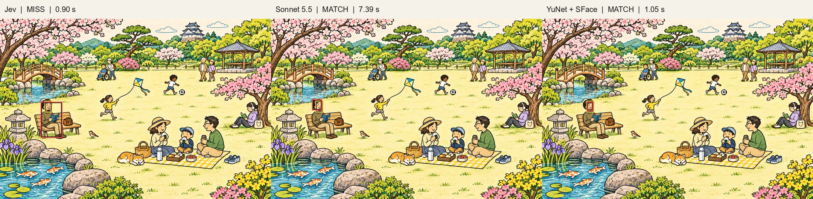
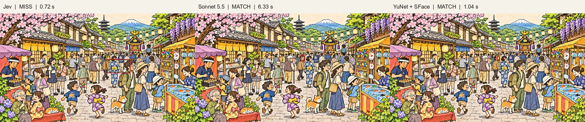
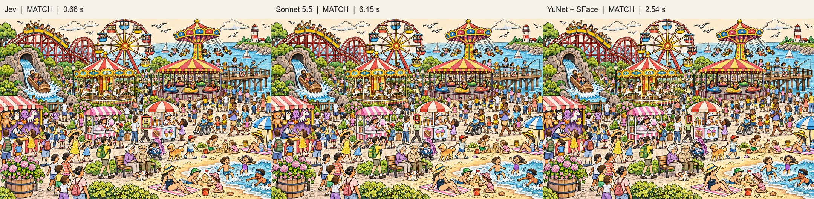
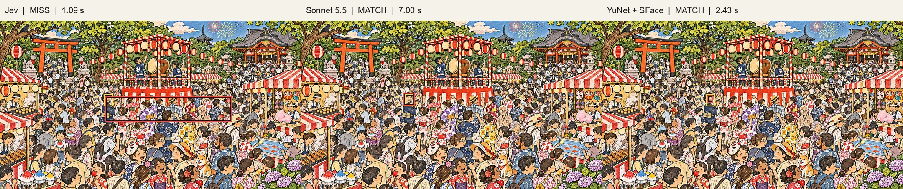
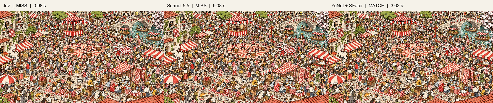

### GPT-6.1 Terra

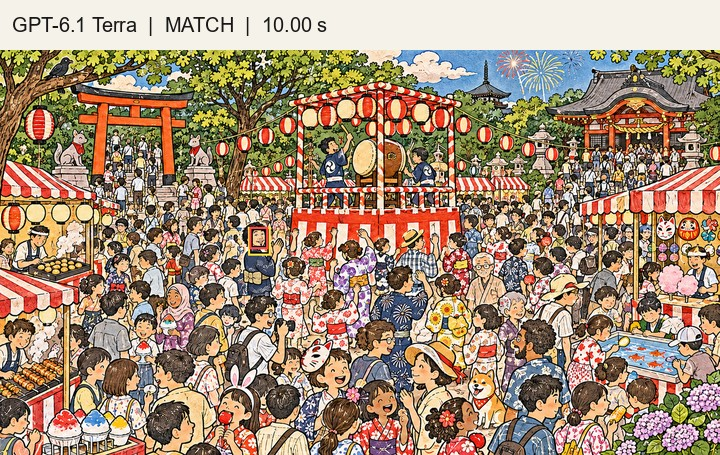
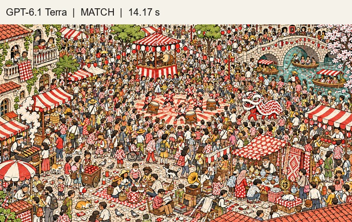

### YuNet + Jev

下の画像は別時刻に実施した試行です。ステージ3と5では「該当なし」を選択しています。

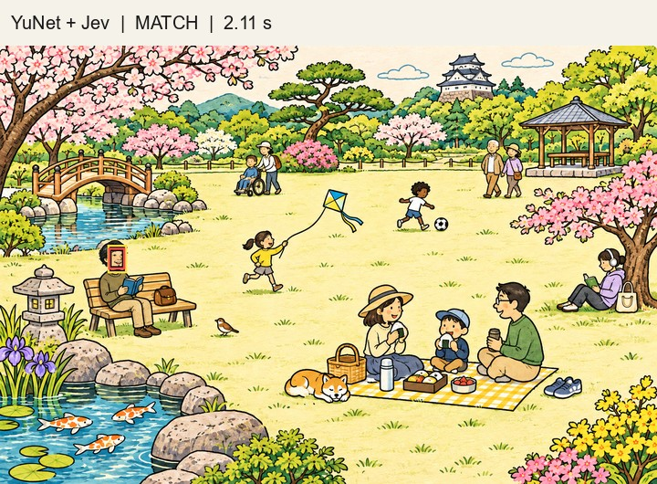
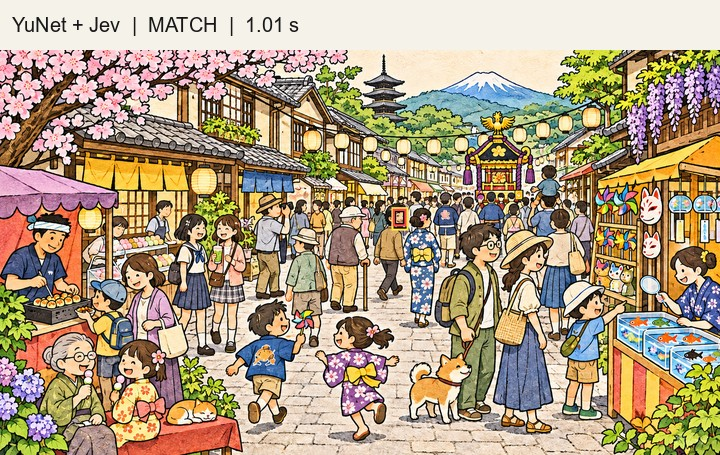
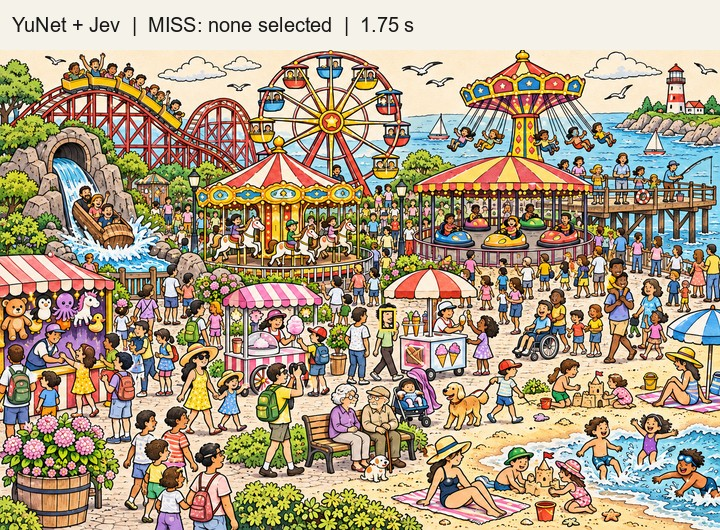

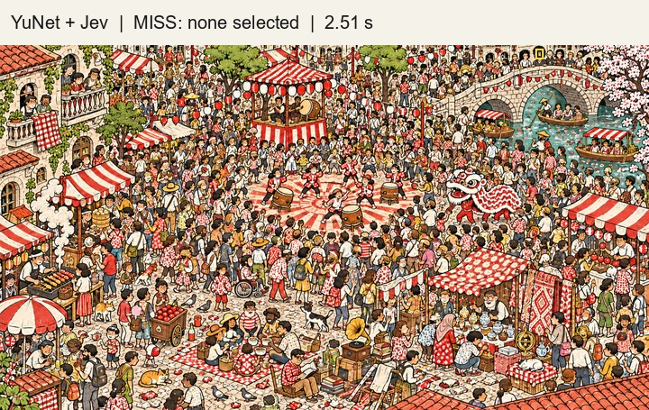

[READMEに戻る](../README.md)
