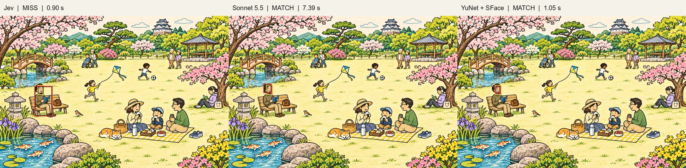
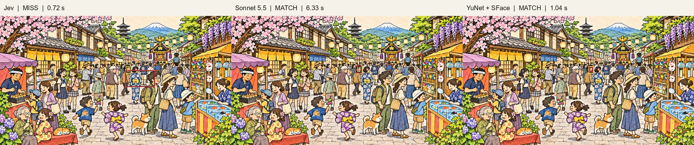
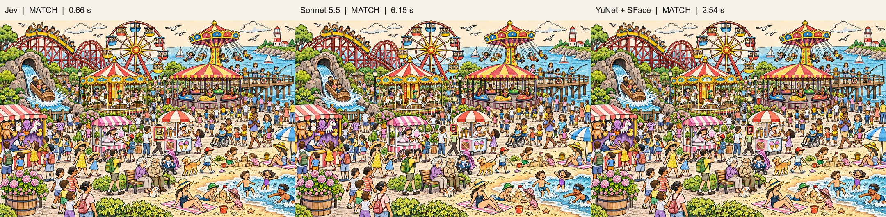
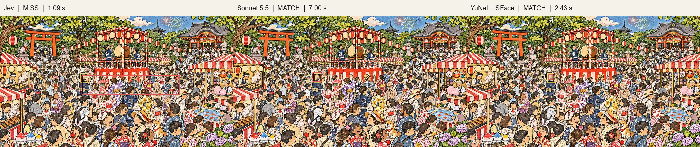
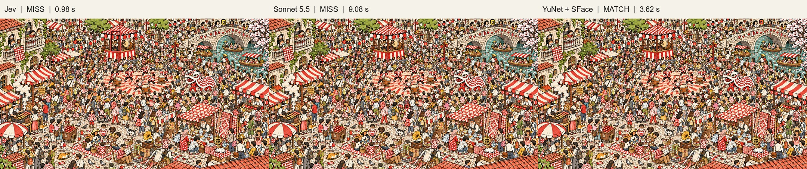
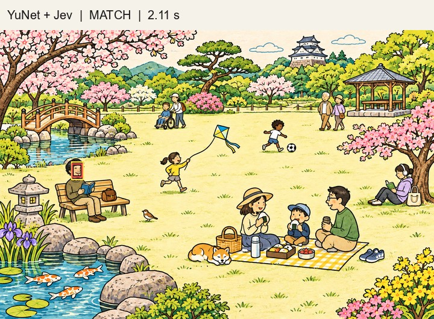
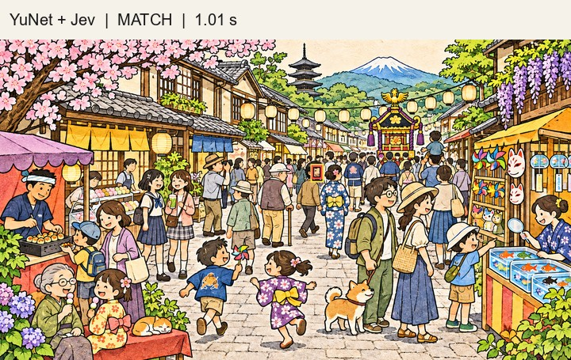
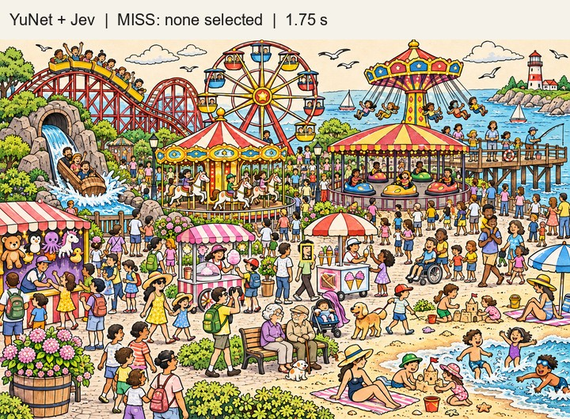
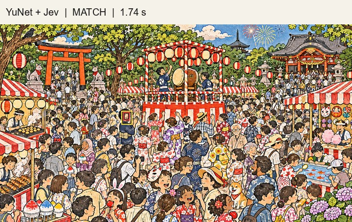
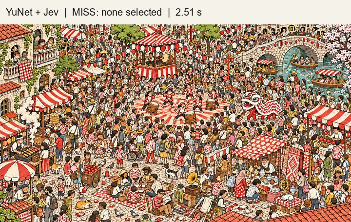

# 推論結果の画像

各ステージの左からJev、Sonnet 5.5、YuNet + SFaceの結果です。**赤が予測した顔枠、黄色が概算の正解顔枠**です。MATCHは中心位置による暫定正解、MISSは不正解を表します。画像を開くと拡大して確認できます。

**ステージ1**

**ステージ2**

**ステージ3**

**ステージ4**

**ステージ5**

## YuNet + Jev：候補一覧からの選択

別の時刻に実施した追加実験です。黄色は正解顔枠、赤はYuNetから選ばれた顔枠を示します。ステージ3と5は「該当なし」を選んだため赤枠はありません。

**ステージ1**

**ステージ2**

**ステージ3**

**ステージ4**

**ステージ5**

[READMEに戻る](../README.md)
