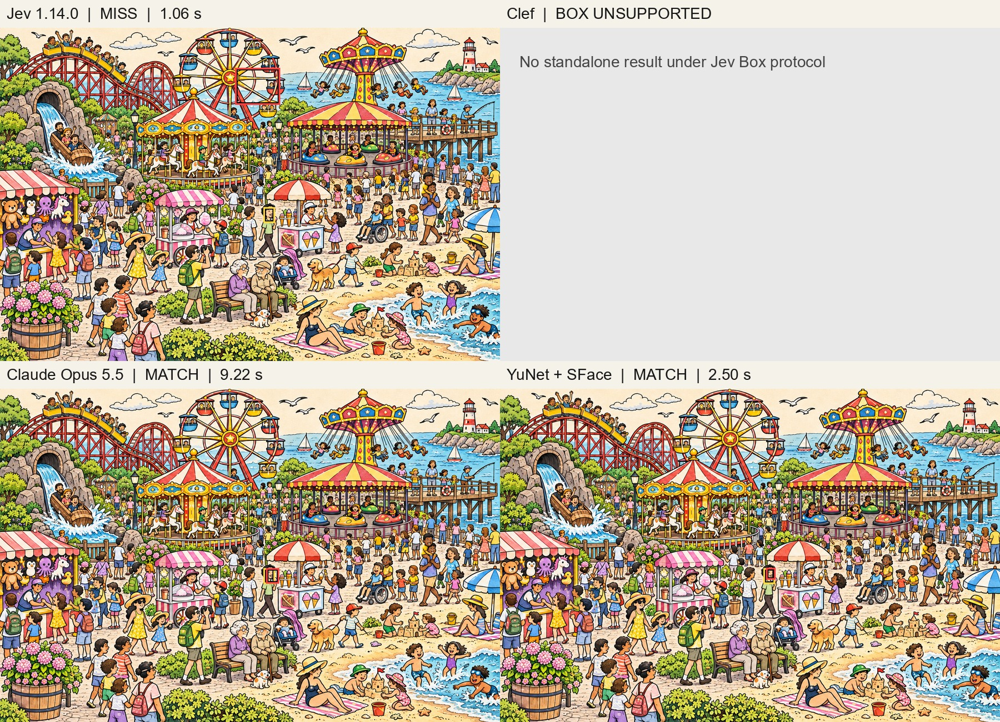

# ステージ3：4手法の推論結果

左上からJev、Clef単体、Claude Opus 5.5、YuNet + SFace。赤が予測枠、黄色が概算の正解顔枠です。この過去の試行ではClefはBox形式非対応のため未測定でした。

- Jev 1.14.0：不正解（1.06秒）
- Clef：当時は未測定（Box形式非対応）
- Claude Opus 5.5：正解（9.22秒）
- YuNet + SFace：正解（2.50秒）

正解は予測枠の中心が概算の正解顔枠に入るかで判定しています。Jev・Opus・SFaceは11月5日の測定で、時間には準備・通信・起動を含みます。YuNet + Clefは別の補助実験です。

このページのJevは顔枠を指示した過去の保存済み実験結果です。最新のレース結果とは異なる実行です。

[全ステージ一覧](inference-results.md) ｜ [READMEに戻る](../README.md)
