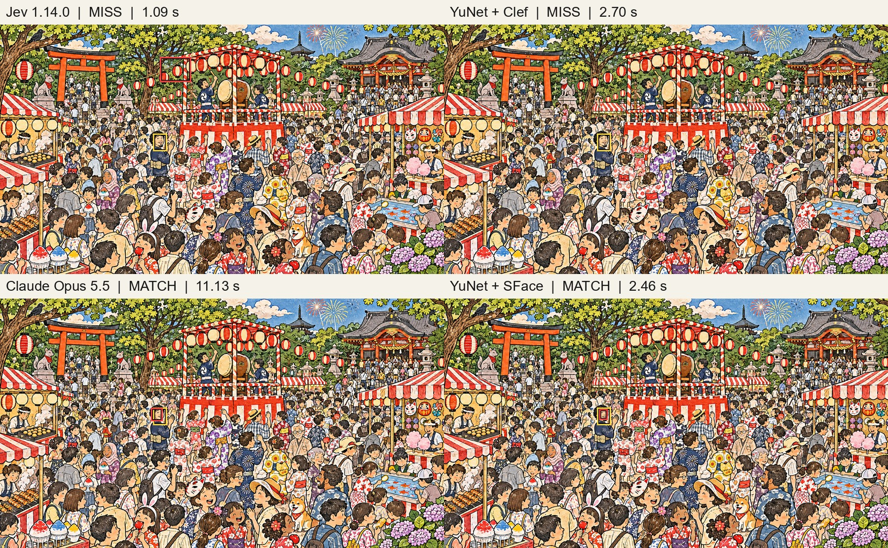

# ステージ4：4手法の推論結果

左上からJev、YuNet + Clef、Claude Opus 5.5、YuNet + SFace。赤が予測枠、黄色が概算の正解顔枠です。画像を開くと拡大できます。

- Jev 1.14.0：不正解（1.09秒）
- YuNet + Clef：不正解（2.70秒）
- Claude Opus 5.5：正解（11.13秒）
- YuNet + SFace：正解（2.46秒）

正解は予測枠の中心が概算の正解顔枠に入るかで判定しています。ClefはYuNetの候補一覧から選択した結果です。Jev・Opus・SFaceは11月5日、Clefは11月6日の別々の測定で、時間には準備・通信・起動を含みます。

このページのJevは顔枠を指示した保存済みの実験結果です。現在のレース画面のJevは人物の可視部分を予測し、人物枠で判定します。

[全ステージ一覧](inference-results.md) ｜ [READMEに戻る](../README.md)
