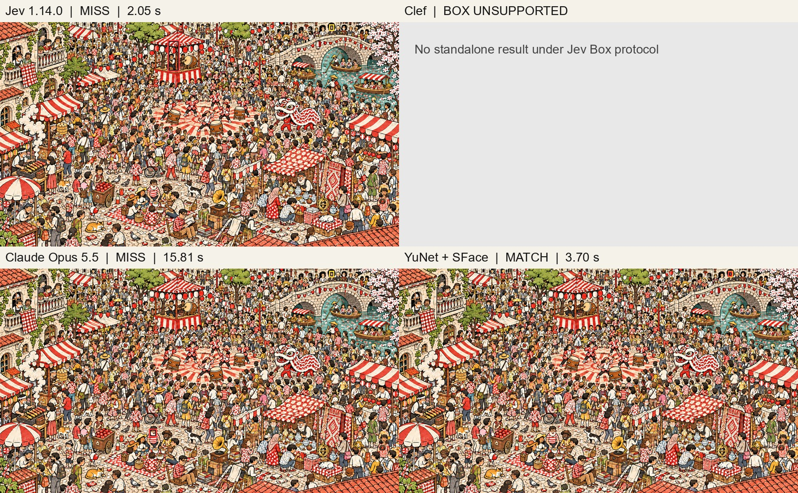

# ステージ5：4手法の推論結果

左上からJev、Clef単体、Claude Opus 5.5、YuNet + SFace。赤が予測枠、黄色が概算の正解顔枠です。Clefは同じBox形式に対応せず未測定です。

- Jev 1.14.0：不正解（2.05秒）
- Clef：未測定（Box形式非対応）
- Claude Opus 5.5：不正解（15.81秒）
- YuNet + SFace：正解（3.70秒）

正解は予測枠の中心が概算の正解顔枠に入るかで判定しています。Jev・Opus・SFaceは11月5日の測定で、時間には準備・通信・起動を含みます。YuNet + Clefは別の補助実験です。

このページのJevは顔枠を指示した保存済みの実験結果です。現在のレース画面のJevは人物の可視部分を予測し、人物枠で判定します。

[全ステージ一覧](inference-results.md) ｜ [READMEに戻る](../README.md)
